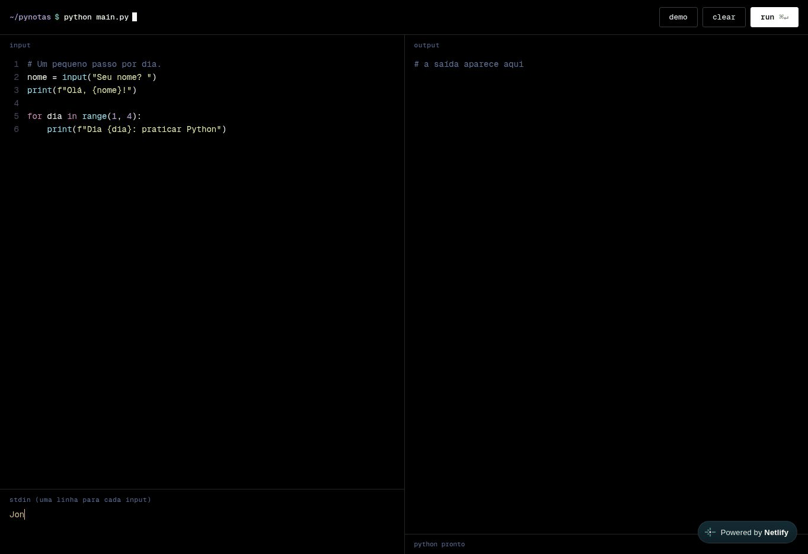
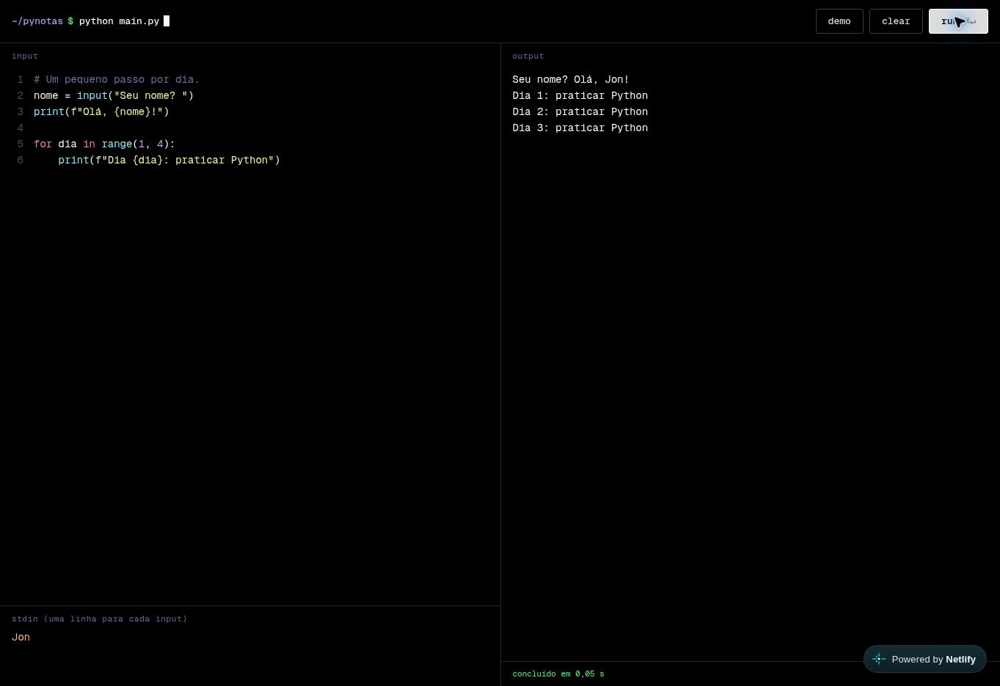
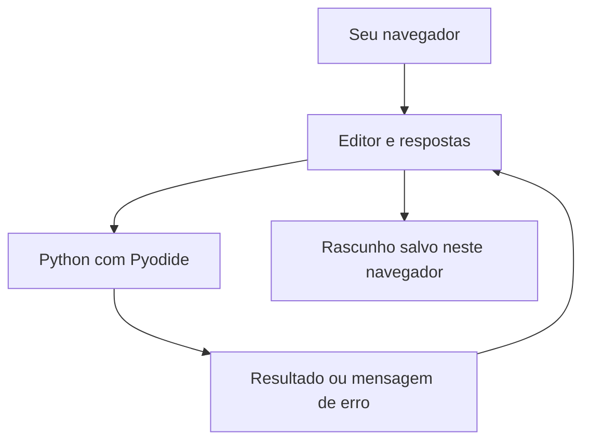

# Py.Notas

**Programar sem burocracia.**

Um espaço simples para praticar Python no computador ou no celular.

[Abrir o Py.Notas](https://pynotas-app.netlify.app/) · [Como usar](#como-usar) · [Roadmap](docs/ROADMAP.md) · [Contribuir](CONTRIBUTING.md)

`Python no navegador` · `Sem cadastro` · `Código aberto` · `MIT`

---
* Eu só queria abrir uma página e praticar Python. Mas as IDEs online que eu encontrava eram lotadas de anúncios e, muitas vezes, travavam no meu navegador. Quando parecia ter encontrado uma opção, vinha o plano premium ou mais um cadastro.

* Como nunca encontrava algo direto ao ponto, com um visual de que eu gostasse, decidi criar minha própria IDE (**Py.Notas**).

* **Além disso,queria contribuir, de alguma forma, para o acesso gratuito a ferramentas que facilitam a prática de programação, seja no desktop ou no celular. Abrir, escrever e testar uma ideia.**

## Veja funcionando

Capturas reais do site: exemplo preparado, execução e resultado. O GIF alterna esses momentos; não é uma gravação contínua.

Ver a imagem estática

## Como usar

1. [Abra o app](https://pynotas-app.netlify.app/) e aguarde a mensagem **python pronto**. Na primeira visita, o carregamento pode demorar um pouco.
2. Escreva seu código na área **input**.
3. Se usar `input()`, preencha as respostas em **stdin**, uma por linha, antes de executar.
4. Clique em **run** e veja o resultado em **output**.

* No computador, você também pode usar `Ctrl + Enter` ou `⌘ + Enter` com o cursor no editor. Durante a execução, **run** vira **stop**. O botão **clear** limpa somente a saída.

## O que já dá para fazer

- Praticar Python sem instalar nada e sem criar conta.
- Escrever com cores no código, linhas numeradas e ajuda na indentação.
- Testar exemplos com perguntas e respostas usando `input()`.
- Interromper uma execução pelo botão **stop**.
- Retomar o último código e as respostas no mesmo navegador.
- Usar o editor e a saída lado a lado no computador; em telas menores, um acima do outro.

**Sobre seus rascunhos:** eles ficam salvos no navegador, não em uma conta. Não há sincronização entre aparelhos. Limpar os dados do site pode apagar o que você escreveu, então mantenha uma cópia dos códigos importantes.

**Sobre a conexão:** o Python é carregado de um serviço externo. Existe cache para reaproveitar arquivos, mas o funcionamento totalmente offline ainda precisa ser validado. Veja as [limitações atuais](docs/GUIA.md#limitações-atuais).

## Por dentro, sem complicar

* A página usa **HTML**, **CSS** e **JavaScript**. Quem permite executar Python no próprio navegador é o **Pyodide**. A execução acontece em um processo separado da interface para que o botão de parar continue disponível.

`HTML` · `CSS` · `JavaScript` · `Pyodide` · `Web Worker` · `PWA`

## O projeto está em construção

* A primeira versão já permite escrever e executar código. Os próximos passos incluem facilitar o uso no celular, importar e baixar arquivos `.py` e melhorar a experiência quando algo dá errado.

O [roadmap](docs/ROADMAP.md) separa o que existe hoje do que ainda está planejado. O [guia do projeto](docs/GUIA.md) explica as pastas e como abrir uma cópia no seu computador.

## Quer contribuir?

* Encontrou um problema ou teve uma ideia? [Abra uma issue](https://github.com/jontsm0/pynotas/issues) e conte o que aconteceu. Para mexer no código, veja o [guia de contribuição](CONTRIBUTING.md).

## Licença

Este projeto usa a [licença MIT](LICENSE). Você pode estudar, modificar e compartilhar o código, mantendo o aviso de licença e autoria.

Feito por [Jonatas Monteiro](https://github.com/jontsm0), enquanto aprende e coloca as ideias em prática.
